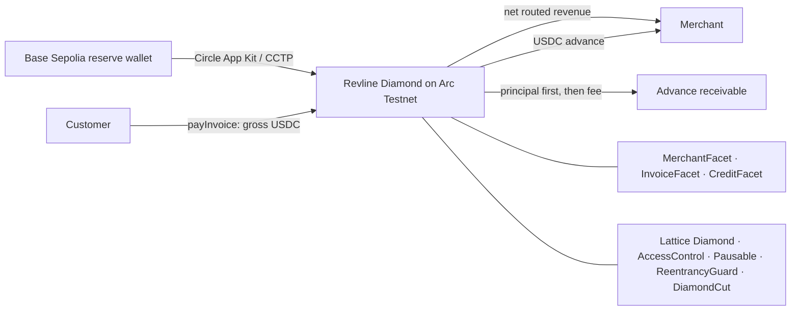

# Revline

Revline turns protocol-routed USDC invoice revenue into underwriter-approved working-capital advances on Arc Testnet.

## Problem

Stablecoin businesses can show cash flow onchain but still lack short-term working capital without posting crypto collateral. Revline makes routed invoice payments visible to the protocol, lets an underwriter enable a merchant, and automatically retires an advance from future routed revenue.

“Verified revenue” means protocol-verifiable Revline invoice payments. It is not fraud-proof business revenue; a merchant can control multiple wallets, so credit remains explicitly underwriter-gated.

## Mechanism and fixed V1 economics

1. A merchant registers and creates fixed-amount USDC invoices.
2. A customer approves the exact amount and calls `payInvoice(invoiceId)`.
3. Only a successful `payInvoice` records verified gross revenue.
4. An underwriter enables the merchant after offchain review.
5. The merchant may draw one advance against trailing 30-day revenue.
6. While an advance is active, each future invoice payment applies 20% to principal first, then the fixed fee; the rest goes to the merchant.

| Term | V1 value |
| --- | ---: |
| Revenue window | 30 UTC days |
| Advance rate | 20% of trailing revenue |
| Minimum trailing revenue | 100 USDC |
| Principal cap | 1,000 USDC |
| Fixed financing fee | 5% of principal |
| Repayment share | 20% of future routed revenue |
| Active advances | One per merchant |

All business amounts use Arc USDC’s six-decimal ERC-20 units. Arc’s 18-decimal native gas balance is never used for protocol accounting.

The Diamond also installs Lattice’s `Receive` facet for empty-calldata native Arc transfers. Native value is accepted at the EVM level but is not ERC-20 reserve liquidity, verified revenue, managed assets, drawable credit, or repayment income. Fund the protocol with an ERC-20 `transfer` to `0x3600000000000000000000000000000000000000`. The MVP has no native-value conversion or withdrawal path; do not send native value expecting it to increase the pool.

```text
managedAssets = liquid USDC + outstanding principal
```

A draw exchanges liquid USDC for a principal receivable, so managed assets do not fall. Principal repayment restores liquidity without creating profit. Only a fee actually repaid increases managed assets and `totalFeesEarned`.

## Architecture



Revline is the product. [Lattice](https://github.com/dadadave80/lattice) is pinned at `2a5df1e95b368b39bf7d043e892ef7a95c3e6588` and is used only for Diamond and security infrastructure; Revline does not use Lattice vault or ERC-4626 modules.

See [docs/architecture.md](docs/architecture.md) for component and trust-boundary details.

## Arc and Circle

- Arc Testnet chain ID: `5042002`
- Explorer: <https://testnet.arcscan.app>
- Arc USDC ERC-20: `0x3600000000000000000000000000000000000000`
- Frontend reads use Arc’s public tokenless RPC.
- Foundry, deployment, and scripts use the credential-bearing `ARC_TESTNET_RPC_URL` supplied out of band in local `.env`; it is never committed or exposed through `VITE_*`.

Circle App Kit bridges reserve liquidity from Base Sepolia directly to the Revline Diamond on Arc. A bridge changes pool liquidity only: it cannot call `payInvoice` and cannot create merchant revenue.

## Deployment and evidence status

No live deployment was performed from this checkout because no signer keys, deployed Diamond address, or local `.env` were available. No addresses or transaction links are fabricated.

| Evidence | Status |
| --- | --- |
| Arc Diamond address | Not deployed from this environment |
| Arc deployment transaction | Unavailable — signer credentials missing |
| Historical invoice transaction | Unavailable — deployment/demo wallets missing |
| Advance draw transaction | Unavailable — deployment/demo wallets missing |
| Post-draw repayment transaction | Unavailable — deployment/demo wallets missing |
| Base Sepolia → Arc Circle bridge | Unavailable — Base Sepolia signer missing |

After a live run, record immutable Arcscan links and Circle source/destination evidence without committing credentials.

## Local setup

Requirements: Foundry, Node.js 22+, npm, and funded Arc Testnet wallets for live transactions.

```sh
git submodule update --init --recursive
npm ci
cd frontend && npm ci && cd ..
cp .env.example .env
cp frontend/.env.example frontend/.env
```

Set local-only values in `.env`: `PRIVATE_KEY`, `ARC_TESTNET_RPC_URL`, `REVLINE_ADDRESS`, `MERCHANT_ADDRESS`, `MERCHANT_PRIVATE_KEY`, `CUSTOMER_PRIVATE_KEY`, and `BASE_SEPOLIA_PRIVATE_KEY`. Set only the public Diamond address in `frontend/.env` as `VITE_REVLINE_ADDRESS`.

Deploy and seed:

```sh
source .env
forge script script/DeployRevline.s.sol:DeployRevline --rpc-url "$ARC_TESTNET_RPC_URL" --broadcast -vvvv
forge script script/SeedDemo.s.sol:SeedDemo --rpc-url "$ARC_TESTNET_RPC_URL" --broadcast -vvvv
```

`SeedDemo` directly funds 1,000 USDC of reserve and routes three real invoices totaling 500 USDC. Use a fresh merchant wallet when repeating it. Direct reserve funding is deliberately excluded from merchant revenue.

Enable a separately registered merchant:

```sh
source .env
forge script script/EnableMerchant.s.sol:EnableMerchant --rpc-url "$ARC_TESTNET_RPC_URL" --broadcast -vvvv
```

Bridge reserve liquidity with Circle App Kit:

```sh
npm run bridge:liquidity -- 100.00
```

Record `poolStats()` before and after bridging. Forwarding fees may make the destination delta lower than the source amount.

Start the frontend:

```sh
cd frontend
npm run dev
```

## Tests

```sh
forge fmt --check
forge build
forge test -vv
cd frontend && npm run build
```

Task 15 verification passes 79 Foundry tests across six suites, including the canonical numerical scenario: 500 USDC routed revenue → 100 USDC credit → 100 USDC draw + 5 USDC fee → 50 USDC invoice → 40 USDC merchant net + 10 USDC principal repayment → 90 USDC principal outstanding, with managed assets unchanged at 1,000 USDC.

## Security limitations

- This is an unaudited testnet MVP and is not production-ready.
- Routed revenue proves that Revline settled a payment, not that merchant and payer are independent; underwriting must account for sybil/wash-payment risk.
- The admin can pause, manage underwriter roles, and upgrade Diamond facets. Admin-key compromise can change protocol behavior.
- Advances are unsecured and have no maturity, default, liquidation, or recovery mechanism; repayment is not guaranteed.
- The institutional reserve has no LP shares or permissionless withdrawals.
- Smart-contract views are authoritative; there is no database or indexer.
- Circle/CCTP finality, forwarding availability, and fees are external operational dependencies.

## Post-MVP roadmap

Production work may add audited contracts, multisig/timelocked administration, stronger merchant and payer verification, receivable/default servicing, monitoring/indexing, and receivable-aware lender accounting. These are intentionally outside the MVP; there is no current claim of fraud-proof underwriting, guaranteed repayment, risk-free yield, or production readiness.

The timed acceptance walkthrough is in [docs/demo-script.md](docs/demo-script.md).
